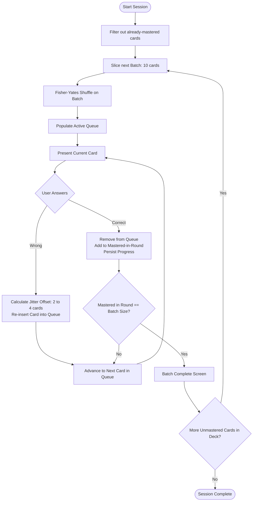
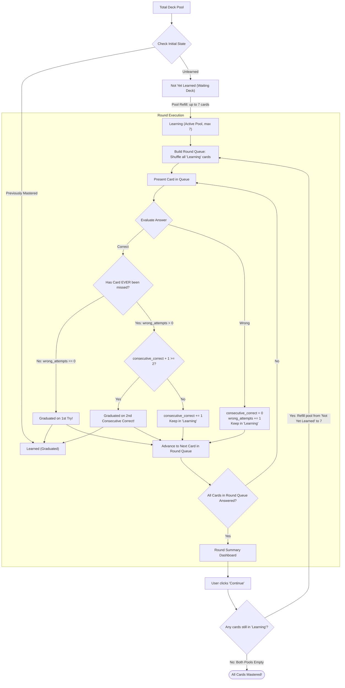

# Functional & Algorithmic Specification: Cram Mode and Quizlet-Style Learn Mode

This specification details the pure mechanics, behavioral rules, state machines, and mathematical formulas governing **Cram Mode** and **Quizlet-style Learn Mode**. It is intentionally free of programming-language-specific code so it can serve as an authoritative blueprint for any tech stack or framework.

---

## 1. High-Level Comparison Matrix

| Aspect | Cram Mode (Học cấp tốc / Nhồi nhét) | Learn Mode (Quizlet Style - Học thông minh) |
|---|---|---|
| **Primary Goal** | Fast short-term memorization before an exam or drill. | Long-term retention through adaptive spaced retrieval practice. |
| **Pacing Strategy** | Fixed-size chunking (batch by batch). | Continuous sliding working memory pool. |
| **Unit of Progress** | Fixed batches of **10 cards** at a time. | Dynamic active pool of **7 cards** at a time (Miller's Law: $7 \pm 2$). |
| **Failure Penalty** | Re-inserts the failed card **2 to 4 positions ahead** in the same batch. | Resets the card's consecutive correct streak to **0**; keeps it in the active pool. |
| **Mastery Criteria** | Answered correctly **1 time** within the batch. | **1 time** (if never missed before) OR **2 consecutive times** (if ever missed). |
| **Between-Rounds Flow** | Simple batch completion modal; proceeds to next 10 cards. | Full Round Summary dashboard with error rate, feedback tiers, and card reviews. |
| **Session End** | All batches have been cleared. | 100% of cards in the deck have graduated to the `Learned` state. |

---

## 2. Feature 1: Cram Mode (Fixed-Chunk Short-Term Consolidation)

### 2.1 The Problem It Solves
When students face a large deck of 100+ questions right before an exam, standard linear review causes cognitive overload. If they miss a question and it is moved to the very end of the 100-card deck, by the time they see it again, the memory trace has completely decayed. Cram Mode solves this via **Fixed-Size Chunking** and **Near-Distance Spaced Re-insertion**.

---

### 2.2 Core Variables & State
For each Cram session, the system maintains:
- **Deck Pool**: All cards eligible for study (excluding cards already mastered in prior sessions).
- **Current Batch**: The active slice of cards (fixed size $B$, default $B = 10$).
- **Active Queue**: The list of cards currently pending in the active round.
- **Queue Pointer**: Index pointing to the card currently displayed to the user.
- **Mastered in Round**: Set of card IDs that have been successfully answered in the current batch.
- **Batch Slice Pointer**: Index in the master deck indicating where the next batch slice begins.

---

### 2.3 Step-by-Step Execution Lifecycle

#### Step 1: Session Initialization
1. Fetch all cards in the selected deck.
2. Filter out any card that is already marked as mastered in the persistent storage.
3. If no unmastered cards remain, mark the session as `Complete`.
4. Slice the first batch: from index `0` up to $\min(10, \text{remaining cards count})$.
5. Apply a **Fisher-Yates shuffle** to this 10-card slice to eliminate order bias.
6. Set the `Active Queue` to this shuffled slice, set `Queue Pointer = 0`, and set `Mastered in Round = empty`.

#### Step 2: Evaluating a Correct Answer
When the user submits the correct answer for the current card:
1. **Remove Card from Active Queue**: The card is spliced out of the `Active Queue`. It will not be shown again in this batch.
2. **Record Mastery**: Add the card ID to `Mastered in Round`.
3. **Persist Progress**: Write the card index into persistent storage immediately.
4. **Pointer Adjustment**: Ensure `Queue Pointer` does not exceed the new length of the queue (clamp to $\text{queue length} - 1$).
5. **Check Batch Completion**:
   - If the size of `Mastered in Round` equals the size of the `Current Batch`:
     - Transition state to `Batch Complete`.
   - Otherwise, display the card now at `Queue Pointer`.

#### Step 3: Evaluating an Incorrect Answer (The Near-Distance Jitter Algorithm)
When the user submits a wrong answer:
1. Remove the current card from its current slot in the `Active Queue`.
2. Do **not** send it to the back of the entire deck.
3. Calculate a **Jitter Offset** ($J$):
   $$J = 2 + \text{random\_integer}(0, 2) \quad \implies \quad J \in \{2, 3, 4\}$$
4. Compute target insertion index:
   $$\text{Target Index} = \min(\text{Current Pointer} + J, \text{Current Queue Length})$$
5. **Re-insert**: Splice the failed card back into the `Active Queue` at `Target Index`.
6. **Edge Case Handling**:
   - *If only 1 card remains in the batch* (queue length is 0 after removal): The card is immediately pushed back into the queue. The user is prompted to try it again.
   - *If the queue has fewer than 2 cards remaining*: The card naturally inserts at the very end of the small queue, appearing 1 or 2 cards later.
7. **Cognitive Purpose**: This forces retrieval practice within 20 to 60 seconds of making a mistake—long enough that the user cannot rely on immediate sensory echo, but short enough that the error context is still fresh.

#### Step 4: Batch Completion & Advancing to Next Batch
1. Once all 10 cards in the current batch have been answered correctly, display a celebration/progress modal.
2. When the user confirms to continue:
   - Check if the `Batch Slice Pointer` has reached or exceeded the total deck size.
   - If yes: The entire study session is finished (`Session Complete`).
   - If no: Slice the next 10 cards from the master deck, shuffle them, reset `Mastered in Round`, and populate a fresh `Active Queue`.

---

## 3. Feature 2: Quizlet-Style Learn Mode (Adaptive Spaced Repetition)

### 3.1 Cognitive Psychology Foundations
Learn Mode is built on two core scientific pillars:
1. **Miller’s Law of Working Memory ($7 \pm 2$)**: Humans cannot efficiently hold dozens of competing novel concepts simultaneously. By constraining the active learning buffer strictly to **7 cards**, working memory is never overloaded.
2. **Leitner System with Error-Sensitive Graduation**: Familiar cards should not waste the user's time, whereas confusing cards must require sustained proof of mastery before being certified as learned.

---

### 3.2 The 3-Tier Card State Model

Every single card in the deck exists in exactly one of three states:

1. **`Not Yet Learned` (Waiting Deck)**:
   - The card is resting in the deck. It has not yet been introduced to the user's working memory.
2. **`Learning` (Active Pool)**:
   - The card is currently inside the active working memory buffer.
   - At any given time, the total number of cards in this state cannot exceed **7**.
3. **`Learned` (Graduated)**:
   - The card has met the strict criteria for mastery and is removed from active circulation.

#### Tracking Metrics per Card
Each card tracks:
- `consecutive_correct`: Current streak of consecutive correct answers (starts at 0).
- `wrong_attempts`: Total times the user has ever answered this card incorrectly across the entire session.
- `total_attempts`: Total number of times this card has been shown.

---

### 3.3 Dynamic Pool Sizing & Replenishment (`Refill Invariant`)

The system enforces this strict invariant:

$$\text{Count}(\text{Learning}) = \min(7, \text{Total Unmastered Cards Remaining})$$

#### Refill Mechanism:
At the start of a round, or whenever cards graduate to `Learned`:
1. Calculate open slots: $\text{Slots Available} = 7 - \text{Count}(\text{Learning})$.
2. If $\text{Slots Available} > 0$:
   - Take the top $\text{Slots Available}$ cards whose status is `Not Yet Learned`.
   - Mutate their status to `Learning`.
3. If no cards remain in `Not Yet Learned`, the active pool naturally shrinks down from 7 towards 0 as cards graduate.

---

### 3.4 Round Queue Generation
Unlike Cram Mode (which removes cards dynamically as they are answered), Learn Mode structures study into distinct **Rounds**:
1. At the beginning of a round, identify all cards currently having status `Learning`.
2. Extract their identifiers and randomize their order using the **Fisher-Yates algorithm**.
3. This randomized list becomes the **Round Queue**.
4. The user must proceed through every card in this Round Queue from index `0` to index $\text{Length} - 1$.

---

### 3.5 The Asymmetric Graduation & Penalty Algorithm

When evaluating a card during a round:

#### Condition A: The User Answers CORRECTLY
1. Increment streak: $\text{consecutive\_correct} = \text{consecutive\_correct} + 1$.
2. **The Asymmetric Graduation Rule**:
   - **Case 1: Pristine / Easy Card** (`wrong_attempts == 0`):
     - If the user has *never* made a mistake on this card, **1 correct answer is sufficient**.
     - Status updates immediately to `Learned`.
     - *Why*: Prevents boredom and wasted effort on material the student already knows well.
   - **Case 2: Previously Failed Card** (`wrong_attempts > 0`):
     - The card was previously missed, indicating memory instability.
     - The card only graduates if $\text{consecutive\_correct} \ge 2$.
     - If $\text{consecutive\_correct} == 1$, the status remains `Learning`. The student must prove retention one more time in a future round.
3. If the card graduates to `Learned`:
   - It is persistently stored as mastered.
   - It will **not** be included in the next round's queue.

#### Condition B: The User Answers INCORRECTLY
1. **The Streak Wipeout Rule**:
   $$\text{consecutive\_correct} = 0$$
   *(Even if the user previously had 1 correct answer, the streak is completely erased).*
2. Increment error counter: $\text{wrong_attempts} = \text{wrong_attempts} + 1$.
3. Status remains `Learning`.
4. The card will appear again in the next round.

---

### 3.6 Round Summary Dashboard & Feedback Engine

When the pointer completes the final card in the Round Queue, the system pauses testing and renders the **Round Summary Screen**.

#### 1. Round Error Rate Calculation:
$$E = \frac{\text{Count of Incorrect Answers in this Round}}{\text{Total Cards Reviewed in this Round}}$$

#### 2. Tiered Motivational Feedback:

| Error Rate Range | Headline Copy | Visual Tone |
|---|---|---|
| $E = 0\%$ | *"Xuất sắc! Hoàn hảo! 🌟"* | Emerald / Celebration |
| $0\% < E < 30\%$ | *"Rất tốt! Tiếp tục nào! 🔥"* | Amber / Encouragement |
| $30\% \le E < 60\%$ | *"Cố lên! Bạn đang tiến bộ! 💪"* | Blue / Support |
| $E \ge 60\%$ | *"Đừng nản! Lặp lại là chìa khóa! 🧠"* | Indigo / Persistence affirmation |

#### 3. Round Audit Gallery:
The dashboard displays a structured card-by-card review of everything practiced in that round:
- **Visual Status**: Green highlight/check for correct items; red highlight/cross for incorrect items.
- **Question Preview**: Image thumbnail or text prompt.
- **Answer Key**: The official correct answer.
- **Retention Status**: Labeled as *"Đúng"* (Mastered or progressed) vs *"Sai — sẽ lặp lại"* (Reset to 0, will re-appear in next round).

---

### 3.7 Advancing to the Next Round
When the user clicks *"Tiếp tục học"* (or presses `Space`/`Enter`):
1. **Trigger Pool Refill**: Check how many slots are open in the 7-card pool (due to cards that graduated during the round). Pull unstudied cards from `Not Yet Learned` to refill the pool to 7.
2. **Check Session Completion**:
   - If the active pool has 0 cards and `Not Yet Learned` has 0 cards:
     - 100% of cards in the deck are now `Learned`.
     - Transition to **Session Complete** screen.
3. **Assemble Next Round**:
   - Collect all cards currently in `Learning`.
   - Run Fisher-Yates shuffle.
   - Reset round pointer to 0 and launch the next round.

---

## 4. Input & Answer Normalization Rules

To ensure reliable evaluation across diverse question formats:

### 4.1 Single-Select vs. Multi-Select Detection
- **Detection Invariant**: If the length of the sanitized answer string $> 1$ (e.g., `"AC"`, `"BD"`), the question is classified as **Multi-Select**.
- **Behavioral Difference**:
  - *Single-Select*: Tapping an option immediately triggers grading and reveals the result.
  - *Multi-Select*: Tapping options toggles selection markers in an active buffer; evaluation only triggers when the user clicks an explicit *"Kiểm tra đáp án"* (Submit) button.

### 4.2 Permutation-Invariant Comparison
User input and stored keys must be sanitized prior to equality comparison:
1. Trim whitespace.
2. Convert all characters to lowercase.
3. Sort characters alphabetically:
   $$\text{"BCA"} \rightarrow \text{['b', 'c', 'a']} \rightarrow \text{['a', 'b', 'c']} \rightarrow \text{"abc"}$$
4. Compare sanitized user selection with sanitized answer key. This guarantees that choosing options A, C, and D in any sequence evaluates as correct.

---

## 5. Keyboard Navigation Specification

| Key Binding | State / Context | Functional Behavior |
|---|---|---|
| Keys `1` to `8` or `A` to `H` | Active Question (Single-Select) | Selects the corresponding option and immediately grades. |
| Keys `1` to `8` or `A` to `H` | Active Question (Multi-Select) | Toggles the corresponding option in the selection buffer. |
| `Space` or `ArrowRight` | Result Showing (Question Feedback) | Advances to the next card in the active queue. |
| `Enter`, `Space`, or `ArrowRight` | Round Summary Screen | Confirms review and triggers the next round. |
| `Escape` | Fullscreen Image / Modal | Closes modal and returns to study flow. |

---

## 6. Edge Cases & Boundary Specifications

1. **Deck Size Smaller Than Pool**:
   - If a deck contains only 4 questions:
     - In Learn Mode: The pool caps at 4 cards instead of 7. The replenishment algorithm gracefully handles empty `Not Yet Learned` queues.
     - In Cram Mode: The batch caps at 4 cards instead of 10.
2. **Resuming Partially-Studied Decks**:
   - When a user re-opens a deck, initialize the pools by querying persistent storage:
     - Any card index in `cramMasteredIndices` is excluded from Cram Mode.
     - Any card index in `learnMasteredIndices` starts directly in the `Learned` state in Learn Mode.
3. **Persistent Failure on Difficult Questions**:
   - If a user repeatedly fails a specific card in Learn Mode, its streak repeatedly resets to 0, and it repeats every round. Because the other 6 slots in the pool continue to graduate and pull new cards in, the user never experiences total deadlock.
4. **Single-Card Cram Jitter**:
   - If only 1 card remains in a Cram batch and is answered incorrectly, target offset calculation would exceed queue bounds. The insertion must clamp to the end of the array, ensuring the card is re-presented cleanly.
