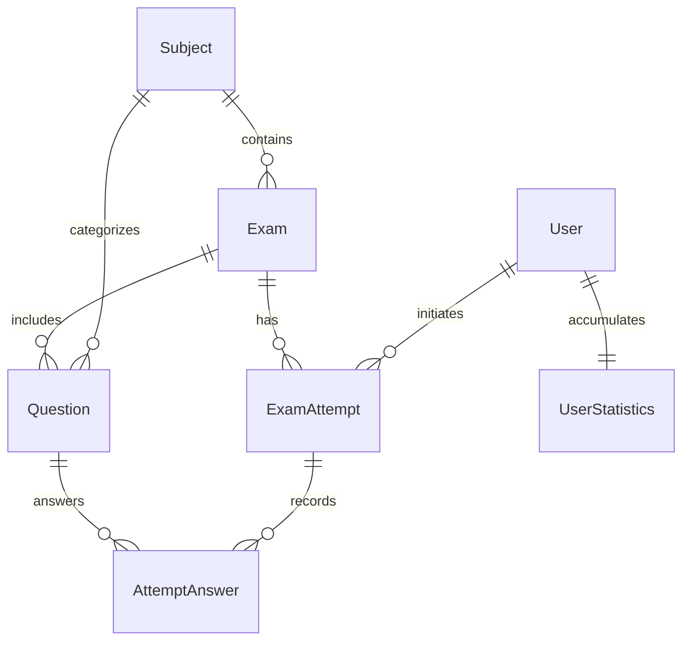
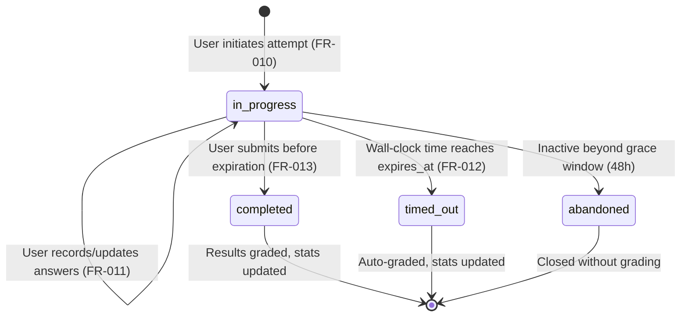

# Data Model: Exam Practice Backend API (Cloudflare D1 & Drizzle ORM)

**Feature**: `001-exam-practice-api`  
**Date**: 2026-11-12  
**Target Database**: Cloudflare D1 (SQLite) via Drizzle ORM  
**Status**: Completed  

---

## Entity Relationship Overview

---

## D1 Table Schemas & Drizzle Mappings

### 1. `users` Table
Represents an individual student or platform user.

| D1 Column | Drizzle Type | Constraints | Description |
| :--- | :--- | :--- | :--- |
| `id` | `text("id").primaryKey()` | UUID string | Unique user identifier |
| `email` | `text("email").notNull().unique()` | Unique, indexed | User email address |
| `password_hash` | `text("password_hash").notNull()` | Hash string | Salted PBKDF2/bcrypt hash |
| `full_name` | `text("full_name").notNull()` | String | User's full display name |
| `is_active` | `integer("is_active", { mode: "boolean" }).notNull().default(true)` | Boolean | Account status flag |
| `created_at` | `text("created_at").notNull()` | ISO 8601 string | Registration timestamp |
| `updated_at` | `text("updated_at").notNull()` | ISO 8601 string | Profile update timestamp |

---

### 2. `subjects` Table
Represents an academic discipline or course.

| D1 Column | Drizzle Type | Constraints | Description |
| :--- | :--- | :--- | :--- |
| `id` | `text("id").primaryKey()` | UUID string | Unique subject identifier |
| `code` | `text("code").notNull().unique()` | Unique, indexed | Subject code (e.g., `MAD101`, `PRO192`, `NWC204`, `OSG202`) |
| `title` | `text("title").notNull()` | String | Human-readable title |
| `description` | `text("description")` | Nullable string | Subject description |
| `icon_url` | `text("icon_url")` | Nullable string | Icon or banner path |
| `created_at` | `text("created_at").notNull()` | ISO 8601 string | Creation timestamp |

---

### 3. `exams` Table
Represents a curated mock examination paper under a subject.

| D1 Column | Drizzle Type | Constraints | Description |
| :--- | :--- | :--- | :--- |
| `id` | `text("id").primaryKey()` | UUID string | Unique exam identifier |
| `subject_id` | `text("subject_id").notNull().references(() => subjects.id)` | FK, indexed | Parent subject reference |
| `code` | `text("code").notNull().unique()` | Unique, indexed | Exam edition code (e.g., `MAD101 - FA25 - FEB5`) |
| `title` | `text("title").notNull()` | String | Exam title |
| `description` | `text("description")` | Nullable string | Exam instructions |
| `duration_minutes` | `integer("duration_minutes").notNull().default(60)` | Integer | Duration in minutes |
| `total_questions` | `integer("total_questions").notNull()` | Integer >= 1 | Number of questions |
| `passing_score_percentage`| `real("passing_score_percentage").notNull().default(70.0)` | Float | Passing score percentage |
| `is_published` | `integer("is_published", { mode: "boolean" }).notNull().default(true)` | Boolean | Visibility status |
| `created_at` | `text("created_at").notNull()` | ISO 8601 string | Ingestion timestamp |

---

### 4. `questions` Table
Represents a practice item in the question bank, conforming to the `exams/` schema.

| D1 Column | Drizzle Type | Constraints | Description |
| :--- | :--- | :--- | :--- |
| `id` | `text("id").primaryKey()` | UUID string | Unique question identifier |
| `subject_id` | `text("subject_id").notNull().references(() => subjects.id)` | FK, indexed | Subject association |
| `exam_id` | `text("exam_id").references(() => exams.id)` | FK, indexed, nullable | Associated exam paper |
| `question_number` | `integer("question_number").notNull()` | Integer | Order within exam paper |
| `question_id_code`| `text("question_id_code").notNull()` | String | Source code (e.g., `Q1`, `Q32`) |
| `question_text` | `text("question_text").notNull()` | String | Question prompt and choices |
| `image_file` | `text("image_file")` | Nullable string | Static asset path (e.g., `Q1.webp`) |
| `question_type` | `text("question_type").notNull()` | String | `single_choice` or `multiple_choice` |
| `options` | `text("options", { mode: "json" }).notNull()` | JSON string | Options dict (`{"A": "...", "B": "..."}`) |
| `correct_answer` | `text("correct_answer").notNull()` | String | Normalized key (e.g., `"C"` or `"ACD"`) |
| `ai_explanation` | `text("ai_explanation")` | Nullable string | Detailed explanation text |
| `option_by_option_analysis` | `text("option_by_option_analysis", { mode: "json" })` | JSON string | Per-choice correctness breakdown |
| `community_stats`| `text("community_stats", { mode: "json" })` | JSON string | Community comment & vote stats |
| `created_at` | `text("created_at").notNull()` | ISO 8601 string | Ingestion timestamp |

---

### 5. `exam_attempts` Table
Represents a student's sitting for a specific exam.

| D1 Column | Drizzle Type | Constraints | Description |
| :--- | :--- | :--- | :--- |
| `id` | `text("id").primaryKey()` | UUID string | Unique attempt identifier |
| `user_id` | `text("user_id").notNull().references(() => users.id)` | FK, indexed | The student taking the exam |
| `exam_id` | `text("exam_id").notNull().references(() => exams.id)` | FK, indexed | The exam being attempted |
| `status` | `text("status").notNull()` | String | `in_progress`, `completed`, `timed_out`, `abandoned` |
| `started_at` | `text("started_at").notNull()` | ISO 8601 string | Attempt start timestamp |
| `expires_at` | `text("expires_at").notNull()` | ISO 8601 string | Fixed wall-clock expiration timestamp |
| `submitted_at` | `text("submitted_at")` | Nullable ISO 8601 | Final submission timestamp |
| `total_questions` | `integer("total_questions").notNull()` | Integer | Total questions evaluated |
| `correct_answers_count` | `integer("correct_answers_count").notNull().default(0)` | Integer | Correct answer count |
| `total_score` | `real("total_score").notNull().default(0.0)` | Float | Raw score points |
| `percentage_score`| `real("percentage_score").notNull().default(0.0)` | Float | Percentage score (0.0 - 100.0) |
| `is_passed` | `integer("is_passed", { mode: "boolean" }).notNull().default(false)` | Boolean | Pass threshold indicator |
| `duration_seconds`| `integer("duration_seconds").notNull().default(0)` | Integer | Elapsed seconds |

---

### 6. `attempt_answers` Table
Records a student's answer to an individual question in an attempt.

| D1 Column | Drizzle Type | Constraints | Description |
| :--- | :--- | :--- | :--- |
| `id` | `text("id").primaryKey()` | UUID string | Unique answer record identifier |
| `attempt_id` | `text("attempt_id").notNull().references(() => exam_attempts.id)` | FK, indexed | Parent attempt session |
| `question_id` | `text("question_id").notNull().references(() => questions.id)` | FK, indexed | Question being answered |
| `selected_options`| `text("selected_options").notNull()` | String | Normalized selection (e.g., `"C"`, `"ACD"`) |
| `is_correct` | `integer("is_correct", { mode: "boolean" }).notNull().default(false)` | Boolean | Exact match indicator |
| `points_awarded` | `real("points_awarded").notNull().default(0.0)` | Float | 1.0 or 0.0 (all-or-nothing) |
| `answered_at` | `text("answered_at").notNull()` | ISO 8601 string | Answer timestamp |

---

### 7. `user_statistics` Table
Aggregated learner performance metrics calculated using the **Best Attempt Model**.

| D1 Column | Drizzle Type | Constraints | Description |
| :--- | :--- | :--- | :--- |
| `user_id` | `text("user_id").primaryKey().references(() => users.id)` | FK, PK | Student identifier |
| `total_attempts_count` | `integer("total_attempts_count").notNull().default(0)` | Integer | Cumulative exam attempts completed |
| `total_exams_passed` | `integer("total_exams_passed").notNull().default(0)` | Integer | Unique exams passed (best score >= pass threshold) |
| `overall_pass_rate` | `real("overall_pass_rate").notNull().default(0.0)` | Float | Passed unique exams / attempted unique exams |
| `overall_average_score`| `real("overall_average_score").notNull().default(0.0)` | Float | Average percentage across all attempts |
| `total_practice_seconds`| `integer("total_practice_seconds").notNull().default(0)` | Integer | Total practice duration in seconds |
| `subject_breakdowns` | `text("subject_breakdowns", { mode: "json" }).notNull().default("{}")` | JSON string | Per-subject statistics summary dictionary |
| `updated_at` | `text("updated_at").notNull()` | ISO 8601 string | Recalculation timestamp |

---

## State Transition Rules

### Exam Attempt Lifecycle

### Business Rules & Constraints

1. **Answer Masking at Edge**: When `status == 'in_progress'`, Drizzle queries explicitly omit `correct_answer`, `ai_explanation`, and `option_by_option_analysis` from returned question objects.
2. **All-or-Nothing Scoring Algorithm**:
   - Single Choice: `selected_options.trim().toUpperCase() === correct_answer.trim().toUpperCase() ? 1.0 : 0.0`.
   - Multiple Choice: Submitted options array is sorted alphabetically and joined into a string (e.g. `["D", "B"]` -> `"BD"`). Evaluated strictly as `submitted_joined === correct_answer ? 1.0 : 0.0`. No partial credit or negative marking.
3. **Best Attempt Aggregation**:
   - Distinct unique passed exams: Count of unique `exam_id` where `max(percentage_score) >= passing_score_percentage`.
   - Per-subject stats: `{ [subject_code]: { attempts: number, avg_score: number, highest_score: number, is_passed: boolean } }`.
