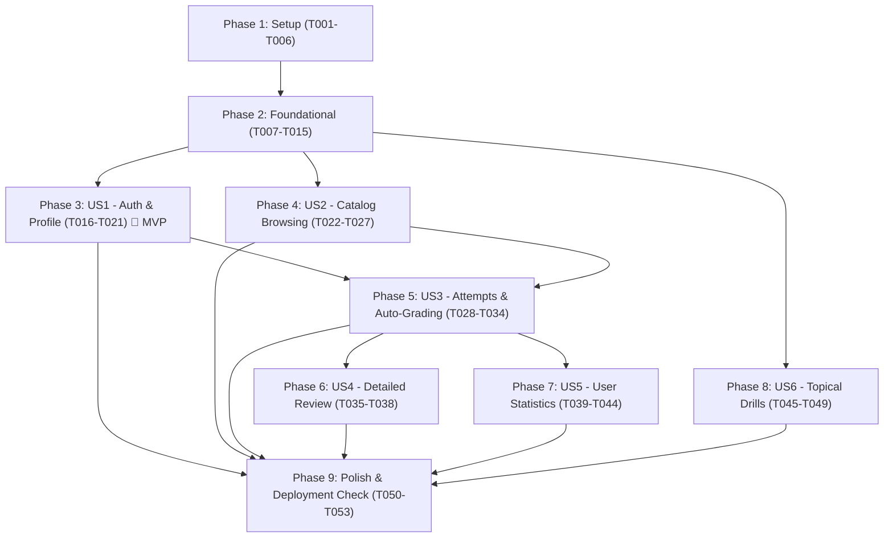

# Tasks: Exam Practice Backend API (Cloudflare Stack)

**Input**: Design documents from `/specs/001-exam-practice-api/`  
**Prerequisites**: [plan.md](plan.md), [spec.md](spec.md), [research.md](research.md), [data-model.md](data-model.md), [contracts/openapi.yaml](contracts/openapi.yaml), [quickstart.md](quickstart.md)  
**Target Platform**: Cloudflare Workers + Cloudflare D1 + TypeScript + Hono + Drizzle ORM  

---

## Format: `- [ ] [TaskID] [P?] [Story?] Description with file path`

- **[P]**: Can run in parallel (different files, no blocking dependencies)
- **[Story]**: User story identifier (`[US1]` - `[US6]`) mapped to `spec.md`
- File paths are exact and project-relative

---

## Phase 1: Setup (Shared Infrastructure)

**Purpose**: Project initialization, Cloudflare Worker tooling, and build environment configuration

- [X] T001 Initialize project manifest with dependencies (`hono`, `@hono/zod-openapi`, `drizzle-orm`, `drizzle-kit`, `zod`, `jose`, `@node-rs/bcrypt`, `wrangler`, `vitest`, `@cloudflare/vitest-pool-workers`, `typescript`) in `package.json`
- [X] T002 [P] Configure strict TypeScript compiler options and module resolution targeting ES2022 in `tsconfig.json`
- [X] T003 [P] Configure Cloudflare Worker bindings (Worker entrypoint `src/index.ts`, D1 database binding `DB`, static assets pointing to `exams/`) in `wrangler.jsonc`
- [X] T004 [P] Configure Drizzle Kit for Cloudflare D1 SQLite dialect and migration output directory `drizzle/` in `drizzle.config.ts`
- [X] T005 [P] Create local environment variables template defining `JWT_SECRET` in `.dev.vars.example` and `.dev.vars`
- [X] T006 [P] Configure Vitest test runner with `@cloudflare/vitest-pool-workers` miniflare isolate environment in `vitest.config.ts` and `tests/setup.ts`

---

## Phase 2: Foundational (Blocking Prerequisites)

**Purpose**: Core D1 SQLite schemas, authentication crypto, error handling, and dataset ingestion from `exams/`

**⚠️ CRITICAL**: No user story implementation can begin until this foundational phase is complete.

- [X] T007 Define Cloudflare Worker environment type bindings (`DB: D1Database`, `JWT_SECRET: string`) in `src/types/env.ts`
- [X] T008 [P] Define complete D1 SQLite database schemas (`users`, `subjects`, `exams`, `questions`, `exam_attempts`, `attempt_answers`, `user_statistics`) with constraints (`notNull()`, `unique()`, `references()`) in `src/db/schema.ts`
- [X] T009 Initialize Drizzle D1 database connection helper taking `env.DB` in `src/db/index.ts`
- [X] T010 [P] Implement password hashing (salted PBKDF2 with SHA-256) and JWT token generation/verification utilities using Web Crypto in `src/core/security.ts`
- [X] T011 [P] Implement structured JSON request logger and performance timing middleware in `src/middleware/logger.ts`
- [X] T012 [P] Implement centralized error-handling middleware with sanitized client error responses in `src/middleware/error.ts`
- [X] T013 Implement base Hono application instance, middleware mounting, and `/health` probe endpoint in `src/index.ts`
- [X] T014 Implement dataset parser function scanning `exams/` directory, parsing answers JSON, normalizing question types (`single_choice`, `multiple_choice`), and inserting records into D1 in `src/seed.ts`
- [X] T015 Create CLI migration and seeding script runner (`npx tsx scripts/seed-d1.ts`) for local and remote D1 databases in `scripts/seed-d1.ts`

**Checkpoint**: Foundation ready. Database migrations, seed pipeline, and core Worker runtime operational.

---

## Phase 3: User Story 1 - User Authentication & Profile Access (Priority: P1) 🎯 MVP

**Goal**: Deliver student account registration, secure login, JWT issuance, authenticated profile lookup, and route guard middleware.

**Independent Test**: Register a new student account, login with credentials, retrieve profile via `GET /api/v1/auth/me` with Bearer token, and verify unauthenticated requests are rejected with 401.

### Tests for User Story 1

- [X] T016 [P] [US1] Integration tests for user registration, duplicate email rejection, login authentication, and profile lookup in `tests/integration/auth.test.ts`

### Implementation for User Story 1

- [X] T017 [P] [US1] Define Zod validation schemas for `RegisterRequest`, `LoginRequest`, `AuthResponse`, and `UserProfileResponse` in `src/schemas/auth.ts`
- [X] T018 [US1] Implement user authentication service (`registerUser`, `loginUser`, `getUserProfile`) using Drizzle queries in `src/services/auth-service.ts`
- [X] T019 [US1] Implement JWT authentication guard middleware validating Bearer tokens and attaching user context in `src/middleware/auth.ts`
- [X] T020 [US1] Implement auth API routes (`POST /api/v1/auth/register`, `POST /api/v1/auth/login`, `GET /api/v1/auth/me`) in `src/api/auth.ts`
- [X] T021 [US1] Mount auth sub-router under `/api/v1/auth` in `src/index.ts`

**Checkpoint**: User Story 1 (Authentication MVP) fully functional and testable independently.

---

## Phase 4: User Story 2 - Subject & Exam Catalog Browsing (Priority: P1)

**Goal**: Allow students to browse available academic subjects (MAD101, NWC204, OSG202, PRO192) and view exams associated with each subject.

**Independent Test**: Query `GET /api/v1/subjects` to list seeded subjects, then query `GET /api/v1/subjects/MAD101/exams` to verify exams with question counts, durations, and passing thresholds.

### Tests for User Story 2

- [X] T022 [P] [US2] Integration tests for subject catalog listing, subject detail lookup, and exam paper listing by subject code in `tests/integration/catalog.test.ts`

### Implementation for User Story 2

- [X] T023 [P] [US2] Define Zod validation schemas for `SubjectSummary`, `SubjectDetail`, `ExamSummary`, and `ExamDetail` in `src/schemas/catalog.ts`
- [X] T024 [US2] Implement catalog service queries (`listSubjects`, `getSubjectByCode`, `listExamsBySubject`, `getExamById`) using Drizzle in `src/services/catalog-service.ts`
- [X] T025 [US2] Implement subject routes (`GET /api/v1/subjects`, `GET /api/v1/subjects/:code`) in `src/api/subjects.ts`
- [X] T026 [US2] Implement exam routes (`GET /api/v1/subjects/:code/exams`, `GET /api/v1/exams/:exam_id`) in `src/api/exams.ts`
- [X] T027 [US2] Mount subject and exam sub-routers under `/api/v1` in `src/index.ts`

**Checkpoint**: User Stories 1 and 2 functional. Students can register, log in, and explore the complete catalog.

---

## Phase 5: User Story 3 - Taking an Exam Attempt & Auto-Grading (Priority: P1)

**Goal**: Support starting an exam attempt, saving answers, enforcing server-authoritative wall-clock duration countdown, and auto-grading with all-or-nothing scoring upon submission or expiration.

**Independent Test**: Start an exam attempt via `POST /api/v1/exams/:id/attempts`, verify questions load without answer keys, record answers via `PUT /api/v1/attempts/:id/answers`, submit via `POST /api/v1/attempts/:id/submit`, and assert percentage score and pass/fail evaluation.

### Tests for User Story 3

- [X] T028 [P] [US3] Unit tests for all-or-nothing scoring engine (single choice exact match, multi-choice sorted combination match, 0 points for partial match, no negative deductions) in `tests/unit/grading.test.ts`
- [X] T029 [P] [US3] Integration tests for attempt session start, incremental answer persistence, wall-clock expiration auto-submit, and submission auto-grading in `tests/integration/attempts.test.ts`

### Implementation for User Story 3

- [X] T030 [P] [US3] Define Zod validation schemas for `AttemptSessionResponse`, `SubmitAnswerRequest`, `AnswerSavedResponse`, and `AttemptResultResponse` in `src/schemas/attempts.ts`
- [X] T031 [US3] Implement all-or-nothing grading service comparing submitted normalized options against answer keys and wall-clock timer expiration in `src/services/grading-service.ts`
- [X] T032 [US3] Implement attempt service (`startAttempt`, `saveAnswer`, `submitAttempt`, `getAttemptSession`) ensuring answer keys are masked during `in_progress` status in `src/services/attempt-service.ts`
- [X] T033 [US3] Implement attempt API endpoints (`POST /api/v1/exams/:exam_id/attempts`, `GET /api/v1/attempts/:attempt_id`, `PUT /api/v1/attempts/:attempt_id/answers`, `POST /api/v1/attempts/:attempt_id/submit`) in `src/api/attempts.ts`
- [X] T034 [US3] Mount attempt sub-router under `/api/v1/attempts` in `src/index.ts`

**Checkpoint**: User Stories 1, 2, and 3 functional. Full exam simulation lifecycle is complete.

---

## Phase 6: User Story 4 - Detailed Attempt Review & Question Explanations (Priority: P2)

**Goal**: Allow students who completed an exam to review their attempt question-by-question, comparing selected answers against correct answer keys, AI explanations, option analyses, and diagram images.

**Independent Test**: Query `GET /api/v1/attempts/:attempt_id/review` for a completed attempt and verify that correct answers, correctness booleans, explanations, and diagram image URLs are revealed. Verify that in-progress attempts reject review requests.

### Tests for User Story 4

- [X] T035 [P] [US4] Integration tests for attempt review endpoint verifying answer unmasking only for completed/timed-out attempts and rejecting in-progress attempts in `tests/integration/review.test.ts`

### Implementation for User Story 4

- [X] T036 [P] [US4] Define Zod validation schemas for `ReviewQuestionItem` and `AttemptReviewResponse` in `src/schemas/review.ts`
- [X] T037 [US4] Implement attempt review service (`getAttemptReview`) joining `attempt_answers` with `questions` and enforcing user ownership in `src/services/review-service.ts`
- [X] T038 [US4] Implement review endpoint (`GET /api/v1/attempts/:attempt_id/review`) in `src/api/attempts.ts`

**Checkpoint**: User Story 4 complete. Students can learn from mistakes with full conceptual explanations and diagrams.

---

## Phase 7: User Story 5 - User Performance Statistics & Progress Tracking (Priority: P2)

**Goal**: Aggregate student performance using the Best Attempt Model (highest score per exam for pass status and subject proficiency; cumulative attempts and practice time), plus chronological attempt history.

**Independent Test**: Complete multiple attempts on exams across subjects, query `GET /api/v1/users/me/stats`, and verify calculated total attempts, passed exams count, overall pass rate, and per-subject metrics.

### Tests for User Story 5

- [X] T039 [P] [US5] Unit tests for best-attempt model calculations (highest score selection, unique exam pass counts, overall average score) in `tests/unit/stats.test.ts`
- [X] T040 [P] [US5] Integration tests for user statistics (`GET /api/v1/users/me/stats`) and paginated attempt history (`GET /api/v1/users/me/attempts`) in `tests/integration/stats.test.ts`

### Implementation for User Story 5

- [X] T041 [P] [US5] Define Zod validation schemas for `SubjectStatsItem`, `UserStatisticsResponse`, and `AttemptHistoryItem` in `src/schemas/stats.ts`
- [X] T042 [US5] Implement statistics service (`recalculateUserStatsOnSubmit`, `getUserStatistics`, `getUserAttemptHistory`) in `src/services/stats-service.ts`
- [X] T043 [US5] Implement user statistics and history endpoints (`GET /api/v1/users/me/stats`, `GET /api/v1/users/me/attempts`) in `src/api/stats.ts`
- [X] T044 [US5] Mount stats sub-router under `/api/v1/users/me` in `src/index.ts`

**Checkpoint**: User Story 5 complete. Learner performance metrics and attempt histories are fully tracked.

---

## Phase 8: User Story 6 - Question Bank Topical Exploration (Priority: P3)

**Goal**: Allow students to practice ad-hoc questions from the question bank filtered by subject with immediate, ephemeral answer checking and explanations without generating formal attempt records.

**Independent Test**: Query `GET /api/v1/questions/drills?subject_code=MAD101`, submit an answer via `POST /api/v1/questions/:id/check`, and verify immediate correctness response without creating an `exam_attempt` record.

### Tests for User Story 6

- [X] T045 [P] [US6] Integration tests for topical question drills retrieval and ephemeral answer check endpoint in `tests/integration/drills.test.ts`

### Implementation for User Story 6

- [X] T046 [P] [US6] Define Zod validation schemas for `PracticeQuestion`, `DrillCheckRequest`, and `DrillCheckResponse` in `src/schemas/questions.ts`
- [X] T047 [US6] Implement drill practice service (`getDrillQuestions`, `checkDrillAnswer`) evaluating answers ephemerally in `src/services/drill-service.ts`
- [X] T048 [US6] Implement question drill endpoints (`GET /api/v1/questions/drills`, `POST /api/v1/questions/:question_id/check`) in `src/api/questions.ts`
- [X] T049 [US6] Mount question drill sub-router under `/api/v1/questions` in `src/index.ts`

**Checkpoint**: All 6 User Stories implemented and independently functional.

---

## Phase 9: Polish & Cross-Cutting Concerns

**Purpose**: Documentation endpoints, static asset caching verification, quickstart validation, and Cloudflare dry-run check

- [X] T050 [P] Verify Cloudflare Workers static asset configuration in `wrangler.jsonc` to serve `.webp` diagrams from `exams/` with cache headers
- [X] T051 [P] Mount Swagger UI documentation at `/ui` and OpenAPI JSON at `/docs/openapi.json` via `@hono/swagger-ui` in `src/index.ts`
- [X] T052 Execute end-to-end quickstart validation suite with `npm test` verifying 100% passing tests per `quickstart.md`
- [X] T053 Validate Cloudflare Worker edge packaging with `npx wrangler deploy --dry-run`

---

## Dependencies & Execution Order

---

## Parallel Opportunities

- **Setup Phase**: T002, T003, T004, T005, T006 can run concurrently.
- **Foundational Phase**: T008 (schema), T010 (crypto), T011 (logger), T012 (error middleware) can run in parallel.
- **User Story Phases**:
  - All test tasks (`[P]`) can be written simultaneously before implementing services.
  - Zod schema files (`[P]`) can be defined in parallel with tests.
  - After Foundational phase:
    - US1 (Auth) and US2 (Catalog) can be worked on concurrently.
    - US6 (Topical Drills) can proceed in parallel with US1/US2.
    - US4 (Review) and US5 (Stats) can proceed in parallel once US3 (Attempts) is complete.

---

## Implementation Strategy

### MVP Scope (User Story 1 + User Story 2)
1. Complete **Phase 1: Setup**
2. Complete **Phase 2: Foundational** (D1 schemas, security utilities, seed pipeline)
3. Complete **Phase 3: User Story 1** (Auth, JWT, profile)
4. Complete **Phase 4: User Story 2** (Catalog browsing)
5. **Validate MVP**: A student can register, log in, and view available subjects and exams.

### Full Delivery
- Phase 5 adds full mock exam sessions with all-or-nothing auto-grading.
- Phase 6 adds conceptual review with AI explanations and diagrams.
- Phase 7 adds cumulative best-attempt analytics.
- Phase 8 adds instant question bank drills.
- Phase 9 verifies edge packaging and one-command Cloudflare deployment.
